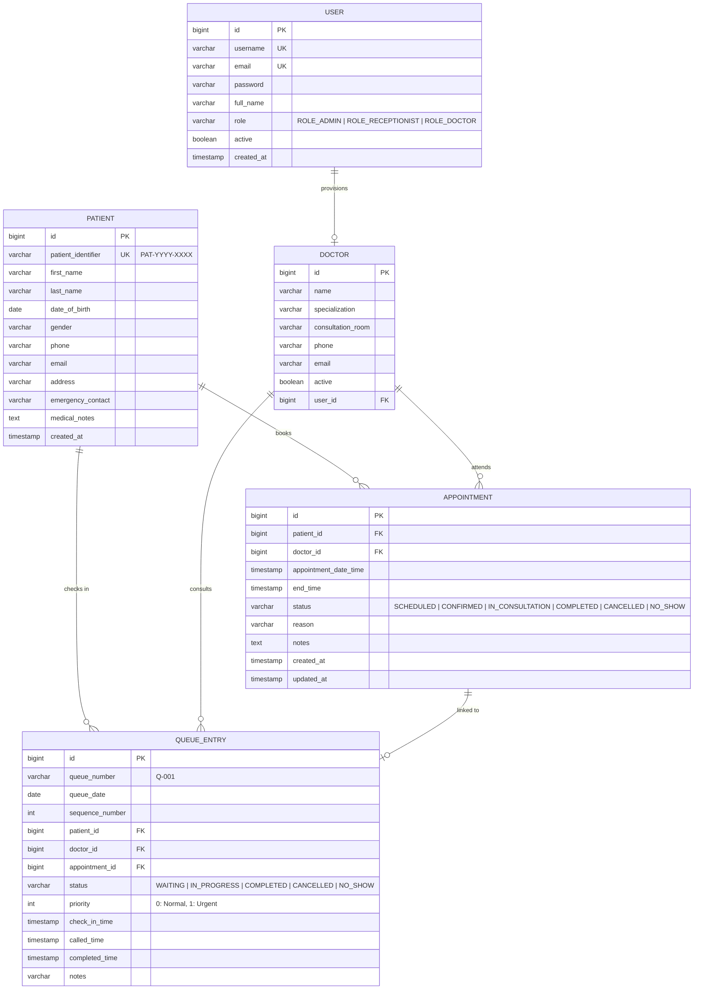
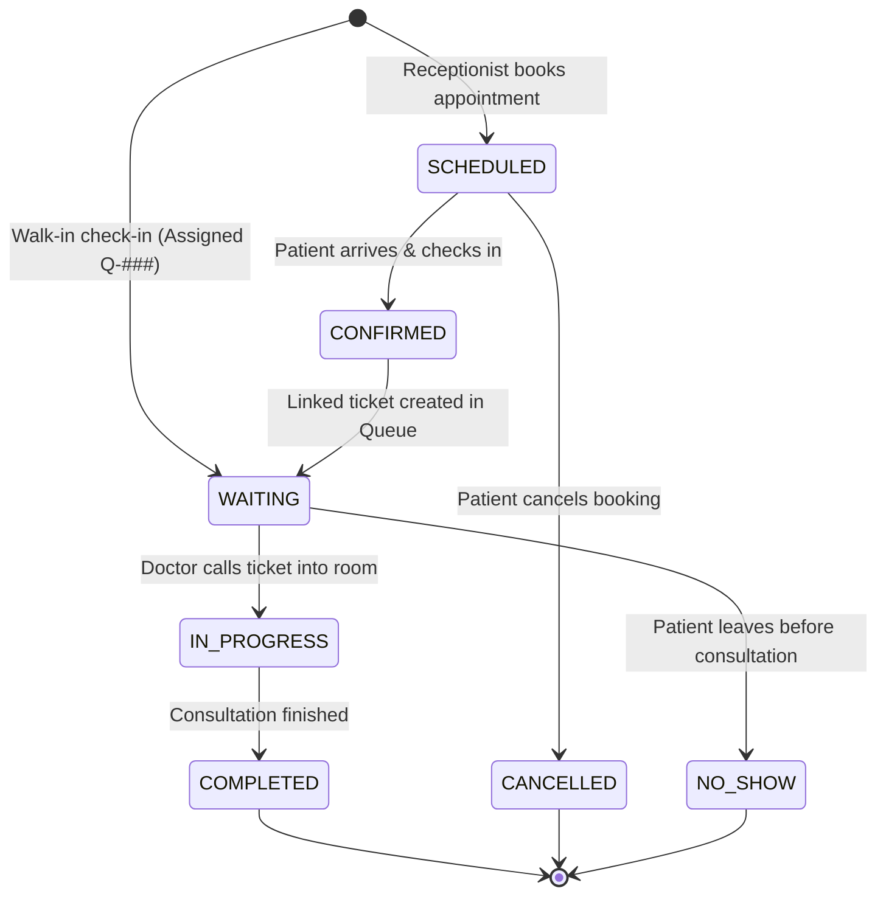

# 🏥 Clinic Management & Real-Time Patient Queue Backend API

[](https://openjdk.org/projects/jdk/21/)
[](https://spring.io/projects/spring-boot)
[](https://www.postgresql.org/)
[](https://spring.io/projects/spring-security)
[](https://www.docker.com/)
[](http://localhost:8085/swagger-ui.html)
[](#automated-testing)

---

## 📌 Executive Summary

### The Problem
Small medical clinics and outpatient practices often manage appointments and daily patient queues manually or using fragmented spreadsheets. This leads to:
1. **Prolonged, uncertain wait times**: Patients sit in waiting areas without knowing their queue position or when they will be seen.
2. **Double bookings & scheduling friction**: Reception staff inadvertently book overlapping appointments for the same physician or patient.
3. **Staff coordination bottlenecks**: Doctors have no real-time visibility into who is checked in, who is up next, or consultation throughput.
4. **Security & access risks**: Administrative functions, patient records, and doctor consultations lack strict role-based separation.

### Our Solution
A backend RESTful API built on **Java 21**, **Spring Boot 3**, **Spring Security 6 (JWT)**, and **PostgreSQL**. The platform delivers:
- **Intelligent Appointment Scheduling**: Conflict-detection engine preventing double bookings for physicians and patients across overlapping time intervals.
- **Dynamic Patient Queue Management**: Automatic sequential ticket assignment (`Q-001`, `Q-002`), real-time queue position calculation, and estimated wait times.
- **Consultation Room Workflow**: Doctor-facing controls to call the next patient (`WAITING` &rarr; `IN_PROGRESS`) and mark consultations as `COMPLETED`.
- **Public Waiting Lounge Display**: Unauthenticated read-only endpoint for digital signage screens in clinic waiting areas.
- **Enterprise-Grade Security**: Stateless JWT authentication with Role-Based Access Control (`ROLE_ADMIN`, `ROLE_RECEPTIONIST`, `ROLE_DOCTOR`).

---

## 🏗️ Architecture & Design Patterns

The application follows clean, layered architecture principles:

```
[ HTTP Requests / Clients / TV Displays ]
                   │
                   ▼
     [ Spring Security & JWT Filter ]
                   │
                   ▼
[ REST Controllers (@RestController) ] ── (Jakarta Bean Validation)
                   │
                   ▼
  [ Service Layer (@Service, @Transactional) ]
   ├── Appointment Conflict Detection Algorithm
   ├── Sequential Queue State Engine
   └── Auth & User Provisioning
                   │
                   ▼
[ Spring Data JPA Repositories (@Repository) ]
                   │
                   ▼
   [ PostgreSQL 16 / H2 In-Memory Database ]
```

### Key Design Patterns Implemented:
1. **Data Transfer Object (DTO) Pattern**: Request and response payloads decouple domain entities from API contracts, protecting sensitive data (e.g., password hashes, internal timestamps).
2. **Collision Detection Algorithm**: Interval overlap query (`[start, end)`) executing indexed SQL queries to ensure no physician or patient has overlapping commitments.
3. **State Machine Lifecycle**: Strictly enforced state transitions for appointments and queue tickets with audit timestamps (`checkInTime`, `calledTime`, `completedTime`).
4. **Global Exception Translation (`@RestControllerAdvice`)**: Centralized RFC 7807-compliant JSON error responses with detailed field validation maps.
5. **Database Indexing Strategy**: B-Tree composite indexes on `(doctor_id, appointment_date_time, end_time)` and `(queue_date, status)` to ensure sub-millisecond query performance under load.

---

## 📊 Entity Relationship Diagram (ERD)



---

## 🔄 Patient Queue & Appointment Lifecycle



---

## 🛠️ Technology Stack

| Technology | Version | Purpose in this Project |
| :--- | :--- | :--- |
| **Java** | 21 LTS | Core language using modern language features (Pattern matching, Records) |
| **Spring Boot** | 3.3.5 | Production application framework and embedded Tomcat runtime |
| **Spring Data JPA / Hibernate** | 6.5 | Object-Relational Mapping (ORM) and declarative queries |
| **PostgreSQL** | 16 | ACID-compliant relational storage for clinic operations |
| **H2 Database** | 2.2 | Fast in-memory database with PostgreSQL compatibility for zero-setup local dev & tests |
| **Spring Security** | 6.3 | Authentication filter chain, password hashing with BCrypt |
| **JJWT** | 0.12.6 | Cryptographically signed HMAC-SHA256 Bearer tokens |
| **SpringDoc OpenAPI** | 2.6.0 | Interactive Swagger UI documentation at `/swagger-ui.html` |
| **JUnit 5 & Mockito** | 5.10 | Unit testing and MockMvc integration tests |
| **Docker & Compose** | 28 / v2 | Multi-stage containerization with Alpine runtime |
| **GitHub Actions** | v4 | Automated continuous integration and test reporting |

---

## 🔐 Role-Based Access Control (RBAC) Matrix

| Endpoint | Method | Public | ROLE_RECEPTIONIST | ROLE_DOCTOR | ROLE_ADMIN |
| :--- | :---: | :---: | :---: | :---: | :---: |
| `/api/v1/auth/login` | `POST` | ✅ | ✅ | ✅ | ✅ |
| `/api/v1/auth/register` | `POST` | ❌ | ❌ | ❌ | ✅ |
| `/api/v1/auth/me` | `GET` | ❌ | ✅ | ✅ | ✅ |
| `/api/v1/queues/display` | `GET` | ✅ | ✅ | ✅ | ✅ |
| `/api/v1/patients/**` | `ALL` | ❌ | ✅ | ❌ | ✅ |
| `/api/v1/doctors` | `GET` | ❌ | ✅ | ✅ | ✅ |
| `/api/v1/doctors/**` | `POST/PUT/DELETE` | ❌ | ❌ | ❌ | ✅ |
| `/api/v1/appointments/**` | `ALL` | ❌ | ✅ | ✅ | ✅ |
| `/api/v1/queues/check-in` | `POST` | ❌ | ✅ | ❌ | ✅ |
| `/api/v1/queues/call-next` | `POST` | ❌ | ❌ | ✅ | ✅ |
| `/api/v1/queues/{id}/status` | `PATCH`| ❌ | ✅ | ✅ | ✅ |
| `/api/v1/queues/summary` | `GET` | ❌ | ✅ | ✅ | ✅ |

---

## 🚀 Getting Started

### Pre-Seeded Demonstration Accounts
When launched with initial seeding enabled, the system automatically provisions fictional staff accounts and clinic records:

| Username | Password | Role | Description |
| :--- | :--- | :--- | :--- |
| `admin` | `Admin@123` | `ROLE_ADMIN` | Clinic Medical Director / System Admin |
| `reception` | `Reception@123` | `ROLE_RECEPTIONIST` | Front Desk Receptionist (Clara Vance) |
| `dr.smith` | `Doctor@123` | `ROLE_DOCTOR` | Cardiologist (Dr. Sarah Smith, Room 101) |
| `dr.jones` | `Doctor@123` | `ROLE_DOCTOR` | General Physician (Dr. Robert Jones, Room 102) |

---

### Option 1: Run with Docker Compose (Recommended for Production)

Make sure Docker and Docker Compose are installed:

```bash
# Clone the repository
git clone https://github.com/clinic/clinic-management.git
cd "Clinic Management"

# Build and start PostgreSQL + Spring Boot API
docker compose up --build -d

# Check service logs
docker compose logs -f app
```

The API and Swagger documentation will be available at:
- **API URL**: `http://localhost:8085`
- **Interactive Swagger UI**: `http://localhost:8085/swagger-ui.html`

To stop:
```bash
docker compose down -v
```

---

### Option 2: Run Locally with Maven Wrapper

The application runs out of the box using an in-memory database with zero external dependencies:

```bash
# Run using the configured Maven Wrapper
./mvnw clean spring-boot:run
```

Or build the standalone executable JAR:
```bash
./mvnw clean package -DskipTests
java -jar target/clinic-management-1.0.0.jar
```

---

## 📡 API Reference & cURL Examples

### 1. Authenticate & Obtain JWT Token
```bash
curl -X POST http://localhost:8085/api/v1/auth/login \
  -H "Content-Type: application/json" \
  -d '{
    "username": "reception",
    "password": "Reception@123"
  }'
```
**Response (200 OK):**
```json
{
  "success": true,
  "message": "Authentication successful",
  "data": {
    "token": "eyJhbGciOiJIUzM4NCJ9...",
    "type": "Bearer",
    "id": 2,
    "username": "reception",
    "email": "reception@clinic.com",
    "fullName": "Clara Vance (Reception)",
    "role": "ROLE_RECEPTIONIST"
  }
}
```

Save the returned token:
```bash
export TOKEN="eyJhbGciOiJIUzM4NCJ9..."
```

---

### 2. Register a New Patient
```bash
curl -X POST http://localhost:8085/api/v1/patients \
  -H "Content-Type: application/json" \
  -H "Authorization: Bearer $TOKEN" \
  -d '{
    "firstName": "Michael",
    "lastName": "Chang",
    "dateOfBirth": "1994-06-18",
    "gender": "Male",
    "phone": "+1-555-0188",
    "email": "m.chang@example.com",
    "address": "88 Pine Street, Springfield",
    "emergencyContact": "Susan Chang (+1-555-0189)",
    "medicalNotes": "No known allergies."
  }'
```
**Response (201 Created):**
```json
{
  "success": true,
  "message": "Patient registered successfully",
  "data": {
    "id": 5,
    "patientIdentifier": "PAT-2026-0005",
    "firstName": "Michael",
    "lastName": "Chang",
    "fullName": "Michael Chang",
    "phone": "+1-555-0188"
  }
}
```

---

### 3. Book an Appointment with Conflict Checking
```bash
curl -X POST http://localhost:8085/api/v1/appointments \
  -H "Content-Type: application/json" \
  -H "Authorization: Bearer $TOKEN" \
  -d '{
    "patientId": 5,
    "doctorId": 1,
    "appointmentDateTime": "2026-10-25T14:00:00",
    "durationMinutes": 30,
    "reason": "Cardiac stress evaluation"
  }'
```

#### Collision Detection Demonstration:
If another patient tries to book Dr. Sarah Smith during the same time interval (`2026-10-25T14:15:00`):
```json
{
  "timestamp": "2026-10-22T10:46:36",
  "status": 409,
  "error": "Conflict",
  "message": "Doctor Dr. Sarah Smith is unavailable. Conflicting appointment [3] scheduled from 2026-10-25 14:00 to 2026-10-25 14:30",
  "path": "/api/v1/appointments",
  "validationErrors": null
}
```

---

### 4. Check In Patient to Today's Queue
```bash
curl -X POST http://localhost:8085/api/v1/queues/check-in \
  -H "Content-Type: application/json" \
  -H "Authorization: Bearer $TOKEN" \
  -d '{
    "patientId": 4,
    "doctorId": 3,
    "priority": 0,
    "notes": "Walk-in patient reporting seasonal allergies"
  }'
```
**Response (201 Created):**
```json
{
  "success": true,
  "message": "Patient checked in to queue successfully",
  "data": {
    "id": 4,
    "queueNumber": "Q-004",
    "queueDate": "2026-10-22",
    "sequenceNumber": 4,
    "positionInQueue": 1,
    "estimatedWaitMinutes": 15,
    "patientIdentifier": "PAT-2026-0004",
    "patientName": "David Wilson",
    "doctorName": "Dr. Emily Chen",
    "consultationRoom": "Room 103",
    "status": "WAITING"
  }
}
```

---

### 5. Doctor Calls Next Patient into Room
```bash
# Authenticate as Doctor
DOCTOR_TOKEN=$(curl -s -X POST http://localhost:8085/api/v1/auth/login \
  -H "Content-Type: application/json" \
  -d '{"username":"dr.smith","password":"Doctor@123"}' | grep -o '"token":"[^"]*' | cut -d'"' -f4)

curl -X POST "http://localhost:8085/api/v1/queues/call-next?doctorId=1" \
  -H "Authorization: Bearer $DOCTOR_TOKEN"
```
**Response (200 OK):**
```json
{
  "success": true,
  "message": "Next patient called into consultation room",
  "data": {
    "id": 2,
    "queueNumber": "Q-002",
    "status": "IN_PROGRESS",
    "calledTime": "2026-10-22T10:46:15",
    "patientName": "Jane Miller",
    "doctorName": "Dr. Sarah Smith",
    "consultationRoom": "Room 101"
  }
}
```

---

### 6. Mark Consultation as Completed
```bash
curl -X PATCH http://localhost:8085/api/v1/queues/2/status \
  -H "Content-Type: application/json" \
  -H "Authorization: Bearer $DOCTOR_TOKEN" \
  -d '{
    "status": "COMPLETED",
    "notes": "Prescribed ACE inhibitors. Follow up in 3 months."
  }'
```

---

### 7. Public Waiting Lounge Display Board
Unauthenticated endpoint designed for TV screens and kiosk dashboards in clinic waiting areas:
```bash
curl http://localhost:8085/api/v1/queues/display
```
**Response (200 OK):**
```json
{
  "success": true,
  "data": {
    "queueDate": "2026-10-22",
    "totalQueued": 4,
    "waitingCount": 2,
    "inProgressCount": 1,
    "completedCount": 1,
    "currentlyServing": [
      {
        "queueNumber": "Q-002",
        "doctorName": "Dr. Sarah Smith",
        "consultationRoom": "Room 101"
      }
    ],
    "waitingList": [
      {
        "queueNumber": "Q-003",
        "positionInQueue": 1,
        "estimatedWaitMinutes": 15
      },
      {
        "queueNumber": "Q-004",
        "positionInQueue": 2,
        "estimatedWaitMinutes": 30
      }
    ]
  }
}
```

---

## 🧪 Automated Testing

The project includes unit and integration tests:
- **`AppointmentServiceTest`**: Validates conflict detection logic, overlapping boundary conditions, rescheduling rules, and invalid cancellation states.
- **`QueueServiceTest`**: Tests atomic queue ticketing, duplicate active check-in prevention, FIFO and priority calling, and illegal state transitions.
- **`AuthControllerIntegrationTest`**: Verifies login success, bad credential rejection (401), missing token protections, and role-based registration gates (403).
- **`AppointmentControllerIntegrationTest`**: Validates HTTP 400 bean validation errors on past dates, HTTP 409 conflict handling, and authenticated rescheduling.
- **`QueueControllerIntegrationTest`**: Tests ticket generation, waiting list positioning, doctor advance actions, and public display board accessibility.

### Running the Test Suite:
```bash
./mvnw test
```

### Execution Results:
```text
[INFO] Running com.clinic.management.service.AppointmentServiceTest
[INFO] Tests run: 6, Failures: 0, Errors: 0, Skipped: 0
[INFO] Running com.clinic.management.service.QueueServiceTest
[INFO] Tests run: 6, Failures: 0, Errors: 0, Skipped: 0
[INFO] Running com.clinic.management.controller.AppointmentControllerIntegrationTest
[INFO] Tests run: 5, Failures: 0, Errors: 0, Skipped: 0
[INFO] Running com.clinic.management.controller.QueueControllerIntegrationTest
[INFO] Tests run: 4, Failures: 0, Errors: 0, Skipped: 0
[INFO] Running com.clinic.management.controller.AuthControllerIntegrationTest
[INFO] Tests run: 5, Failures: 0, Errors: 0, Skipped: 0
[INFO] 
[INFO] Results:
[INFO] Tests run: 26, Failures: 0, Errors: 0, Skipped: 0
[INFO] BUILD SUCCESS
```

---

## 💡 Interview Discussion Points

When discussing this codebase in technical interviews, highlight these engineering decisions:

1. **How do you prevent double bookings under concurrent traffic?**
   - *Answer*: Collision validation is enforced using database index-backed interval overlap logic (`appointmentDateTime < :newEnd AND endTime > :newStart`) combined with Spring's `@Transactional` service methods. In high-concurrency production deployments, pessimistic locking (`PESSIMISTIC_WRITE`) or unique slot constraint indexes can be applied.

2. **How is the patient queue sequence managed without gaps or race conditions?**
   - *Answer*: Queue numbering uses an atomic sequence lookup per day (`findTopByQueueDateOrderBySequenceNumberDesc`) inside a synchronized transaction, formatting tickets cleanly as `Q-001`, `Q-002`. Active check-in uniqueness (`findByPatientIdAndQueueDateAndStatusIn`) stops patients from grabbing duplicate tickets simultaneously.

3. **Why Stateless JWT instead of Server-Side Sessions?**
   - *Answer*: Small clinics frequently connect multiple client devices (reception desktop, doctor tablets, waiting room kiosk displays). Stateless JWT tokens with short TTL and role claims eliminate session affinity requirements and enable zero-downtime container scaling.

4. **Why return structured ErrorResponse instead of Spring's default error pages?**
   - *Answer*: Modern frontend and mobile clients expect standardized schemas. Our `@RestControllerAdvice` translates `MethodArgumentNotValidException`, `AppointmentConflictException`, and security rejections into consistent JSON payloads containing timestamps, status codes, paths, and field-level error messages.

---

## 📄 License
This project is open-source under the [Apache 2.0 License](LICENSE).
